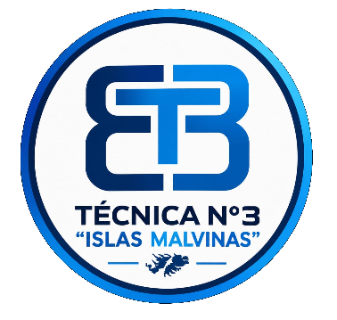

# E.E.S.T. N.º 3 «Islas Malvinas» — Sitio Web Oficial



Sitio web institucional desarrollado para la **Escuela de Educación Secundaria Técnica N.º 3 «Islas Malvinas»** de Lanús. El proyecto    reúne información académica, recorridos virtuales por la escuela, noticias y la propuesta de inscripción para el ciclo lectivo 2027.

---

## ¿Qué es este proyecto?

Es una página web estática diseñada para centralizar y presentar la información de la institución a estudiantes, familias y la comunidad educativa. Incluye secciones para conocer la escuela, explorar las tecnicaturas, recorrer el edificio de forma virtual y acceder a los datos de contacto y ubicación.

---

## Live Server

IMPORTANTE: ejecutar con VS Code + Live Server.
Como header.html y footer.html se cargan con fetch(), no alcanza con abrir index.html haciendo doble clic.
Instalá la extensión Live Server, hacé clic derecho en index.html y elegí "Open with Live Server".

---

## ¿Cómo ver el sitio en local?

**IMPORTANTE:** El sitio utiliza `fetch()` para cargar el encabezado (`header.html`) y el pie de página (`footer.html`). Por este motivo, **no alcanza con abrir el `index.html` haciendo doble clic**. Es necesario utilizar un servidor local.

### Pasos para ejecutarlo:
1. Descargá o cloná este repositorio:
   ```bash
   git clone https://github.com/xdbenja966-cell/tecnica3.git

## Estructura del proyecto

El sitio està organizado de la siguiente manera:
<table>
    <tr>
      <th>Paginas Principales (.html)</th>
    </tr>
</table>

<table>
     <tr>
        <th>index.html</th>
        <th>Página de inicio con bienvenida y acceso rápidos</th>
     </tr>
  </th>
    <tr>
      <td>nosotros.html</td>
      <td>Información sobre la institución y su propuesta educativa</td>
    </tr>
    <tr>
      <td>tecnicaturas.html</td>
      <td>Detalle de las carreras (Programación, Turismo y construccion) con enlaces a los PDF</td>
    </tr>
   <tr>
      <td>noticias.html</td>
      <td>Novedades y actividades de la comunidad educativa</td>
   </tr>
   <tr>
      <td>talleres.html</td>
      <td>Información sobre los espacios de aprendizaje práctico</td>
   </tr>
   <tr>
      <td>mapa.html</td>
      <td>Recorrido virtual interactivo (planta baja y primer piso mediante ThingLink)</td>
   </tr>
   <tr>
      <td>galeria.html</td>
      <td>Fotografías de los espacios de la escuela</td>
   </tr>
   <tr>
      <td>inscripcion.html</td>
      <td>Formulario de interés para el ciclo lectivo 2027</td>
   </tr>
   <tr>
      <td>ubicacion.html</td>
      <td>Mapa de Google Maps y datos de cómo llegar</td>
   </tr>
   <tr>
      <td>contacto.html</td>
      <td>Datos de contacto institucional y redes sociales</td>
   </tr>
</table>

## componentes compartidos

- header.html: Encabezado con el menú de navegación y logo
- footer.html: Pie de página con enlaces rápidos, contacto y redes

## Recursos y lógica

<ul>
   <li>styles.css: Hoja de estilos principal (diseño responsive, colores institucionales, tarjetas, etc.).</li>
   <li>script.js: Lógica del sitio (carga de header/footer, menú móvil, pestañas del mapa, visor de imágenes y validación del formulario).</li>
   <li>assets/: Carpeta con todas las imágenes del sitio (logos, fotos de la fachada, patios, talleres, etc.).</li>
   <li>pdf/: Carpeta que contiene los documentos informativos de las tecnicaturas:</li>
   <ul>
      <li>pdf/programacion.pdf</li>
      <li>pdf/turismo.pdf</li>
      <li>pdf/construccion.pdf</li>
   </ul>
</ul>

## Características técnicas

- Diseño 100% Responsive: Adaptado para computadoras, tablets y celulares.
- Header y Footer dinámicos: Se cargan mediante JavaScript para evitar duplicar código en cada página.
- Mapa interactivo: Integración con escenas de ThingLink para recorrer el edificio.
- Visor de imágenes (Lightbox): Galería que permite ampliar las fotos haciendo clic en ellas.
- Formulario de inscripción: Actualmente es una maqueta visual. No envía ni almacena datos reales. Para ponerlo en funcionamiento, debe conectarse a un sistema autorizado por la escuela.

## Tecnologías utilizadas
- HTML5 — Estructura semántica.
- CSS3 — Estilos, variables, Flexbox y CSS Grid.
- JavaScript — Lógica del menú, visor de imágenes, mapa y formulario.
- Font Awesome — Iconografía.
- Google Maps — Geolocalización.
- ThingLink — Mapas interactivos en 360°.

## Créditos
Desarrollado por Benjamín Suarez de 6°2 de Programación de la E.E.S.T. N.º 3 «Islas Malvinas» para la materia Diseño Web Estático
